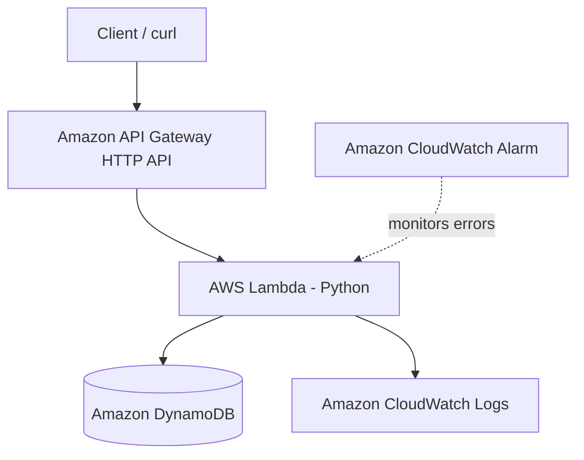

# Berlyn's Serverless Expense Tracker API

CS79C AWS Architecture Portfolio Project.

## Overview

This serverless API lets a user add an expense and list saved expenses. It is defined as infrastructure as code in `expense-tracker.yaml`.

## Architecture



## AWS services

- **API Gateway HTTP API** — exposes `GET /expenses` and `POST /expenses`.
- **AWS Lambda** — validates and processes requests.
- **Amazon DynamoDB** — stores expense items with on-demand billing.
- **Amazon CloudWatch** — receives Lambda logs and has an alarm for Lambda errors.
- **AWS CloudFormation** — creates and configures the resources from the template.

Lambda and DynamoDB scale using their managed/serverless capacity models. DynamoDB uses `PAY_PER_REQUEST`.

## Deployment

Prerequisites: AWS CLI configured with an authorized account and region `us-west-2`.

```bash
aws sts get-caller-identity
aws cloudformation deploy \
  --template-file expense-tracker.yaml \
  --stack-name cs79c-expense-tracker \
  --capabilities CAPABILITY_IAM \
  --region us-west-2
```

Get the API URL:

```bash
aws cloudformation describe-stacks \
  --stack-name cs79c-expense-tracker \
  --region us-west-2 \
  --query "Stacks[0].Outputs" \
  --output table
```

## Test

Replace `API_URL` with the `ApiEndpoint` output.

```bash
curl -i -X POST "API_URL" \
  -H "Content-Type: application/json" \
  -d '{"amount":12.50,"category":"Food","description":"Lunch"}'

curl -i "API_URL"
```

The POST request should return HTTP 201; GET should return HTTP 200 and include the saved expense.

## Evidence

Add genuine screenshots to `evidence/` after deploying and testing:
1. CloudFormation stack status `CREATE_COMPLETE`.
2. POST test showing the expense saved.
3. GET test showing the saved expense.
4. DynamoDB item record.
5. Lambda/CloudWatch log and alarm details.

Do not include account access keys, passwords, or other secrets in screenshots.

## Cost and cleanup

The template uses serverless services and DynamoDB on-demand billing, but AWS charges can still apply. Check AWS Billing and Cost Management during and after testing. After collecting evidence, delete the stack if you no longer need the resources:

```bash
aws cloudformation delete-stack \
  --stack-name cs79c-expense-tracker \
  --region us-west-2
```

Confirm deletion in CloudFormation. The report should describe only tests and results that were actually observed.
